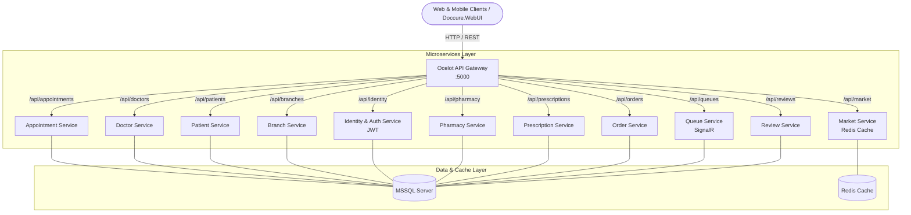

# 🏥 Doccure - Enterprise Healthcare & Telemedicine Microservices Platform

[](https://dotnet.microsoft.com/)
[](https://microservices.io/)
[](https://github.com/ThreeMammals/Ocelot)
[](https://redis.io/)
[](https://dotnet.microsoft.com/apps/aspnet/signalr)
[](https://www.microsoft.com/sql-server)

**Doccure**, modern sağlık ve hastane süreçlerini dijitalleştirmek amacıyla geliştirilmiş, **Mikroservis Mimarisi** ve **API Gateway** desenini benimseyen kapsamlı bir kurumsal sağlık & teletıp platformudur.

---

## 📌 Proje Genel Bakış ve Mimari

Sistem; monolitik yapıların getirdiği bakım zorluklarını, bağımlılıkları ve tek noktadan çökme (single point of failure) risklerini ortadan kaldırmak için birbirinden bağımsız, ölçeklenebilir 11 mikroservis ve merkezi bir API Gateway etrafında kurgulanmıştır.



---

## 🏗️ Mikroservisler ve Sorumluluk Alanları

| Mikroservis | Açıklama & Temel Fonksiyonlar |
| :--- | :--- |
| **`Doccure.Gateway`** | Ocelot tabanlı API Gateway. Tüm istemci isteklerini karşılar, yönlendirir, yük dağıtır ve güvenliği sağlar. |
| **`Doccure.IdentityService`** | JWT (JSON Web Token) tabanlı merkezi kimlik doğrulama, kullanıcı rolleri ve yetkilendirme. |
| **`Doccure.DoctorService`** | Doktor profilleri, uzmanlık branşları, müsaitlik takvimleri ve biyografi yönetimi. |
| **`Doccure.PatientService`** | Hasta kayıtları, tıbbi geçmiş, iletişim bilgileri ve profil yönetimi. |
| **`Doccure.AppointmentService`** | Randevu oluşturma, onaylama, iptal süreçleri ve randevu takvimi optimizasyonu. |
| **`Doccure.BranchService`** | Poliklinik ve tıbbi branşların dinamik listesi ve hiyerarşik yönetimi. |
| **`Doccure.PharmacyService`** | Eczane stokları, medikal ürünler ve ilaç envanter takibi. |
| **`Doccure.PrescriptionService`** | Doktorlar tarafından hastalara dijital reçete yazılması ve eczane entegrasyonu. |
| **`Doccure.MarketService`** | Medikal market ürün listeleri ve yüksek performans için **Redis Cache** entegrasyonu. |
| **`Doccure.OrderService`** | E-ticaret / medikal sipariş oluşturma, faturalama ve sipariş durumu takibi. |
| **`Doccure.QueueService`** | Canlı poliklinik sıra takip sistemi (Numaratör) ve **SignalR** canlı bildirimleri. |
| **`Doccure.ReviewService`** | Hastaların doktorlara ve hizmetlere yönelik değerlendirme ve puanlama (rating) sistemi. |
| **`Doccure.WebUI`** | Modern ASP.NET Core MVC tabanlı, Admin ve Kullanıcı panellerini barındıran ön yüz. |

---

## 🛠️ Kullanılan Teknolojiler ve Kütüphaneler

* **Backend Çerçevesi:** .NET Core / C#
* **Mimari Deseni:** Microservices Architecture, API Gateway Pattern, Repository & CQRS / DTO Patterns
* **API Gateway:** Ocelot
* **Veritabanı & ORM:** Microsoft SQL Server, Entity Framework Core / Dapper
* **Önbellekleme (Caching):** Redis Cache
* **Gerçek Zamanlı İletişim:** SignalR (Canlı bildirimler & Sıra takibi)
* **Kimlik Doğrulama:** JWT (JSON Web Token) & ASP.NET Core Identity
* **Frontend:** ASP.NET Core MVC (Razor), HTML5, CSS3, JavaScript, Bootstrap
* **Konteynerizasyon & Dağıtım:** Docker, Portainer

---

## 🚀 Projeyi Yerel Ortamda Çalıştırma

### Gereksinimler
* [.NET 8.0 SDK](https://dotnet.microsoft.com/download)
* [SQL Server](https://www.microsoft.com/sql-server)
* [Redis](https://redis.io/) (Docker veya Local)
* [Visual Studio 2022](https://visualstudio.microsoft.com/) veya [VS Code](https://code.visualstudio.com/)

### Kurulum Adımları

1. **Repoyu Klonlayın:**
   ```bash
   git clone https://github.com/furkantopaldev/Doccure-Microservices.git
   cd Doccure-Microservices
   ```

2. **Veritabanı Bağlantı Dizelerini (Connection Strings) Ayarlayın:**
   * İlgili mikroservislerin `appsettings.json` dosyalarındaki MSSQL bağlantı adreslerini kendi yerel veritabanınıza göre güncelleyin.

3. **Veritabanı Migration'larını Uygulayın:**
   ```bash
   dotnet ef database update --project Microservices/Doccure.IdentityService
   # İhtiyaç duyulan diğer servisler için migration komutlarını çalıştırın
   ```

4. **API Gateway ve Servisleri Başlatın:**
   * Visual Studio kullanıyorsanız **Multiple Startup Projects** seçeneğinden `Doccure.Gateway`, `Doccure.WebUI` ve çalıştırmak istediğiniz mikroservisleri aynı anda başlatın.

---

## 📊 Sunum ve Değerlendirme Notları

* **Ölçeklenebilirlik:** Her servis bağımsız olarak ölçeklenebilir ve ayrı sunucularda barındırılabilir.
* **Hata İzolasyonu:** Bir mikroserviste (örneğin `ReviewService`) meydana gelebilecek bir kesinti ana randevu veya kimlik doğrulama akışını etkilemez.
* **Gevşek Bağlılık (Loose Coupling):** Servisler kendi DTO'ları ve bağımsız veritabanı şemaları üzerinden çalışarak modülerliği maksimize eder.

---

## 👨‍💻 Geliştirici

* **Furkan Topal** - [GitHub Profili](https://github.com/furkantopaldev)
